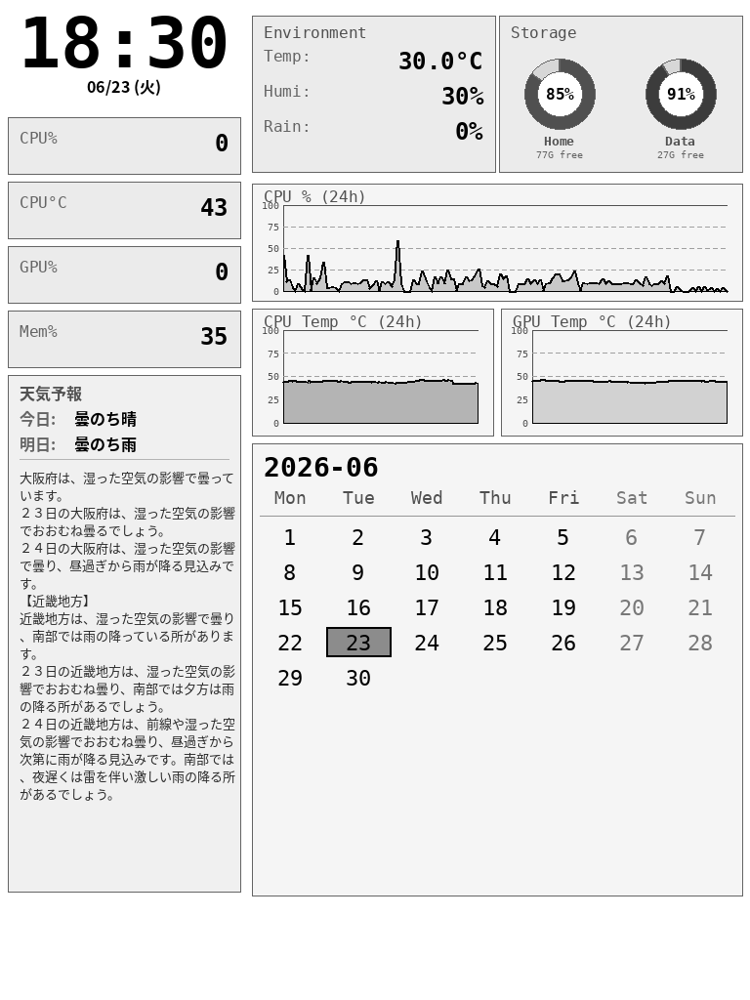

# Kindle Monitor

リビングのセンサーデータ、システム情報、天気予報、ストレージ使用量、カレンダーをリアルタイムで Kindle Paperwhite e-ink ディスプレイに表示するダッシュボードプロジェクトです。

<p align="center">
  
</p>

## 対応機種

- **Kindle Paperwhite Gen.5** (768×1024, 6 inch, E ink 213 ppi)

## 機能

### 左ナビゲーション（246px 幅 / 全幅 32%）

- **大型時刻表示**（72pt 太字）
- **日付・曜日表示**（日本語: 月/火/水/木/金/土/日）
- **システム情報カード**: CPU%, CPU°C, GPU%, Mem%
- **天気予報**:
  - 今日・明日の天気（テキスト表記: 晴れ/曇り/雨 等）
  - 詳細説明文（気象庁テキストを全文ラップ表示）

### メインパネル

- **Environment カード**: 温度・湿度・降水確率（Wio Link 連携）
- **Storage カード**: ドーナツチャートでファイルシステム使用率を可視化
  - Home ファイルシステム（ユーザーホーム所在 FS）
  - `/dev/sda3`（findmnt で自動マウントポイント検出）
  - 使用率に応じた動的色分け（90%超は警告色）
  - 空き容量 GB も併記
- **CPU% トレンドグラフ**（24h、25% 刻みグリッド）
- **CPU/GPU 温度トレンドグラフ**（左右 2 分割、25% 刻みグリッド）
- **縮小カレンダー**（今週＋来週の2行）: 土日の灰色表示、祝日の背景塗り＋枠取り（jpholiday）、今日のハイライト枠
- **Claude カード**: 5h / 7d 使用率バーとリセット時刻。取得できない場合は状態（`token expired` / `rate limited` など）と最終成功値の経過時間を表示し、ローカルログから集計した直近5hのトークン量（概算）を常に併記
- **Claude Code Sessions カード**: 直近セッション（プロジェクト・モデル・文脈量・経過時間、`●`稼働中 / `○`待機中）。会話本文は読まない

## アーキテクチャ

```
[Wio Link]  [気象庁]  [psutil/nvidia-smi]  [disk_usage]
    ↓          ↓             ↓                  ↓
        get_*() データ取得関数群
                ↓
    DATA_HISTORY (deque, 144 points = 24h)
                ↓
        create_image() PIL レンダリング
                ↓
        /tmp/panel.png 生成
                ↓
        SFTP → Kindle (paramiko)
                ↓
        eips コマンドで e-ink 描画
```

## セットアップ

### 1. 依存関係のインストール

```bash
pip install -r requirements.txt
```

### 2. 設定ファイルの作成

```bash
cp config.yaml.example config.yaml
```

**config.yaml** で以下を設定:

- `kindle.ip_address`: Kindle の IP（直接接続に使用）
- `kindle.ssh.password` または `private_key_path`: SSH 認証
- `sensors.wio_link.sensor.node_id` / `access_token`: Wio Link ノードとトークン
- `sensors.weather.city_code`: 気象庁地域コード（例: 270000 = 大阪）
- `anthropic.enabled`（任意）: `true` で Claude カードと Sessions カードを表示。認証は `~/.claude/.credentials.json` の OAuth トークンを使用（リフレッシュはしない）

### 3. セキュリティ設定

#### SSH 鍵認証（推奨）

```bash
ssh-keygen -t rsa -b 4096 -f ~/.ssh/kindle_id_rsa -N ""
ssh-copy-id -i ~/.ssh/kindle_id_rsa.pub -p 22 root@<kindle-ip>
```

`config.yaml` で指定:

```yaml
kindle:
  ssh:
    private_key_path: "/home/user/.ssh/kindle_id_rsa"
    password: null
```

## 実行

### 手動実行

```bash
python3 kindle_display_enhanced.py
```

### Cron 自動実行（15 分間隔、`setup_cron.sh` でも登録可）

`run_kindle_display.sh` は cron 環境（pyenv 等）を吸収するラッパースクリプトです。

```bash
crontab -e
```

```cron
*/15 * * * * cd /home/<user>/Projects/kindle_monitor/ && bash /home/<user>/Projects/kindle_monitor/run_kindle_display.sh >> /home/<user>/Projects/kindle_monitor/logs/run.log 2>&1
```

ラッパーが自動的に行うこと:
- `HOME`, `PATH`, `LANG`, `TZ` の cron-safe な明示セット
- pyenv の有効化（`PYENV_ROOT/shims` を PATH 先頭に）
- pyenv の絶対パス python を優先使用
- `~/.env.kindle` を読み込み（存在すれば）

## ファイル構成

| ファイル | 用途 |
|---------|------|
| `kindle_display_enhanced.py` | **本番版** メインスクリプト |
| `kindle_ai_status.py` | Claude クォータ / Claude Code セッションの取得（キャッシュ・バックオフ付き） |
| `config.yaml` | 設定ファイル（git 管理外） |
| `config.yaml.example` | 設定テンプレート |
| `.env.kindle.template` | 環境変数テンプレート（`~/.env.kindle` にコピー、任意） |
| `DEPLOYMENT.md` | 本番デプロイ手順 |
| `run_kindle_display.sh` | Cron 用ラッパー |
| `setup_cron.sh` | Cron セットアップ補助 |
| `~/.kindle_monitor_data.json` | データ履歴（自動生成、24h ローリング） |
| `~/.kindle_monitor_claude_cache.json` | Claude クォータの最終成功値とバックオフ状態（自動生成） |

## レイアウト仕様

- **解像度**: 768×1024（Paperwhite Gen.5 ネイティブ）
- **セーフエリア**: 高さの 90%（上下に余白）
- **左ナビ幅**: 246px (32%)
- **グレースケール**: e-ink 4 階調最適化
  - 0 (黒): 数値、本文
  - 80-120 (中間灰): ラベル、土日、補助線
  - 210-245 (淡灰): 背景、カード塗り

## トラブルシューティング

### Claude カードが `token expired` / `rate limited` のまま

使用率 API は非公式で、トークン失効や 429 が起こりえます。本プロジェクトはトークンを更新せず、最終成功値（`cached Nm ago`）とローカル集計の表示で継続します。`token expired` は `~/.claude/.credentials.json` が更新されていない状態です（Claude Code でログインし直すと復帰する場合があります）。

### Cron 実行は走るがエラー終了する

pyenv を使っている場合、cron は `~/.bashrc` を source しないため、`/usr/bin/python3` が呼ばれて pip パッケージが見つかりません。`run_kindle_display.sh` ラッパー経由で実行してください（pyenv の絶対パスを使用します）。

### ストレージ表示が片方だけ

`/dev/sda3` が見つからない場合は片側のみ表示されます。`findmnt /dev/sda3` で確認してください。デバイス名を変更したい場合は `get_storage_usage()` を編集してください。

### 日本語が文字化け

Noto Sans CJK フォントをインストール:

```bash
sudo apt install fonts-noto-cjk
```

### Kindle に接続できない

- `ping <kindle-ip>` で疎通確認
- Kindle が SSH モードで起動しているか確認
- ファイアウォール設定を確認

## ライセンス

個人利用目的のプロジェクトです。
